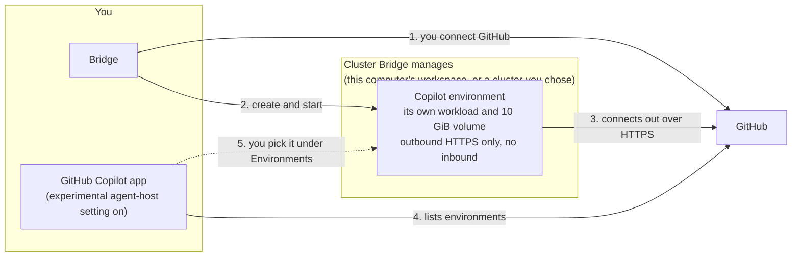

# Using Bridge from the GitHub Copilot app

> **Status: planned, not available yet.** Nobody has run this end to end, and the current release doesn't offer it. This page describes the intended flow and what exists in Bridge today, so the pieces can be checked as they land.

## The idea

Once Bridge is set up and connected to GitHub, you could start work from the GitHub Copilot app and have it run in a workspace Bridge manages, instead of only from Bridge's own window. In the Copilot app, Bridge's workspace would appear as an environment you can pick.

## Intended flow

1. **Connect GitHub in Bridge.** This is the step Bridge already has for the AI connection; how the environment gets its own GitHub credential is not decided yet (see [Open questions](#open-questions)).
2. **Bridge creates and starts a Copilot environment** on the cluster you choose: its own workload with its own storage, started only when you ask.
3. **The environment connects out to GitHub.** It accepts no inbound connections, so it reaches GitHub over outbound HTTPS rather than anything connecting to it.
4. **In the GitHub Copilot app**, with its experimental agent-host setting turned on, the environment appears in the list of environments.
5. **You pick it under Environments**, and work you start there runs in that environment.

## What exists in Bridge today

- **AI for Bridge's own agents.** Agents in Bridge's workspace reach GitHub Copilot through a model proxy bundled in the workspace image (Vekil), which Bridge starts when you connect the AI. That proxy is for agents inside the workspace; it isn't the environment described here, and it isn't reachable from the Copilot app.
- **A native owner for Copilot environments.** Bridge's native code can create, discover, start, stop and remove an environment on a Kubernetes cluster it can reach:
  - A `PersistentVolumeClaim` (10 GiB) for the environment's files.
  - A `NetworkPolicy` that allows no inbound traffic, and outbound traffic only to DNS and to public addresses on TCP 443.
  - A `Deployment` that stays at zero replicas until Start, runs as a non-root user with the default seccomp profile, and doesn't mount a Kubernetes service-account token.
  - Ownership records in Bridge's app data, so Bridge only stops or removes environments it created, and checks the workload hasn't been changed before starting it.
- **What's missing.** That owner isn't connected to any command or screen yet, and the program the environment runs (the part that would connect to GitHub and appear in the Copilot app) isn't part of this repository. Until both exist, nothing in Bridge shows this flow.

## Open questions

- Which GitHub credential the environment uses, how it's scoped, and where it's stored. Bridge's AI connection today copies your GitHub sign-in into the workspace for the model proxy; an environment that acts in the Copilot app may need something different.
- How the Copilot app discovers an environment, and what it can do in it.
- Where the environment runs by default: this computer's workspace or a cluster you choose.

When these are settled and the flow has been run end to end, this page will become instructions.
